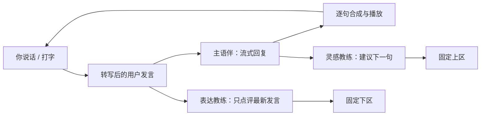

<div align="center">


# 轻松说 · EasySpeak

**像跟朋友聊天一样，练习你想说的语言。**

成人 AI 口语陪练 · 两个独立辅导区 · 多语言交流 · 自定义训练

[快速开始](#快速开始) · [功能说明](./morrow/docs/features.md) · [开发规范](./morrow/CONTRIBUTING.md) · [非商用许可](./LICENSE)

</div>

「轻松说」是一款移动优先的口语陪练 Web App。主语伴陪你自然交流，上方教练帮你想“接下来可以说什么”，下方教练只点评“刚才这句话”。三个角色分别更新，让练习始终围绕聊天展开。

你可以选择熟悉语言和练习语言，使用自己的模型 API Key，也可以导入文章、简历、词汇或图片，围绕自己的材料练习。

> **源码公开，禁止未经授权的商业使用。** 项目采用 PolyForm Noncommercial 1.0.0，允许在许可范围内非商用使用、修改和分发。由于存在用途限制，它属于 source-available（源码可用），不是 OSI 定义的开源软件。完整条款见 [LICENSE](./LICENSE)。

## 功能亮点

| 功能         | 使用方式                                                                                   |
| ------------ | ------------------------------------------------------------------------------------------ |
| 自然语音对话 | 半双工轮流说话：AI 说完再开麦，停说后转写、回复并朗读；也能打字交流                        |
| 两个固定教练 | 上区给思路、词组和可展开例句；下区只点评最新用户发言，各自更新、各自重试                   |
| 多语言与难度 | 选择熟悉语言和练习语言，支持互换、自定义语言代码与 A1–C1 难度参考                          |
| 自定义训练   | 在场景选择中输入练习要求，添加文章、简历、词汇等材料；导入预览确认后开始，可保存模板       |
| 文档与图片   | 支持 TXT、Markdown、CSV、文本 PDF、DOCX、PNG、JPG、WebP；文档本机提取，图片由视觉模型读取  |
| 多供应商     | MiniMax、DeepSeek、OpenAI、通义千问和自定义 Chat Completions 兼容接口；教练可选独立模型 ID |
| 音色与停顿   | 十二个具名 MiniMax 音色、试听、设备声音、自定义音色 ID；二 / 三 / 五秒停顿等待             |
| 学习与复习   | 十二节交际任务、表达收藏、自动错题、间隔复习、个人目标及按语言组合统计                     |
| 轻量聊天界面 | 四种主题、字幕隐藏、按需翻译、纠错后重练、文字记录导出                                     |

**摄像头目前只用于本机预览，AI 看不到镜头内容。** 实时视频理解暂不实现；自定义训练中的图片理解是独立功能，需要主动选择图片和支持视觉输入的模型。

## 快速开始

需要 **Node.js 22.13+（建议使用 Node.js 24）**、npm 和现代浏览器。浏览器语音识别建议使用 Chrome / Edge；实际语言和设备能力以所选服务为准。

获取源码后，在项目目录执行：

```sh
cd morrow
npm ci --cache .npm-cache
npm run dev
```

打开终端显示的地址，默认是 <http://127.0.0.1:5173/>。首次使用：

1. 打开右上角设置，在“模型设置”选择供应商，填写 Base URL、个人 API Key 和模型 ID。
2. 在“语音与偏好”选择浏览器识别 / 设备声音，或配置 MiniMax ASR / TTS。
3. 允许麦克风访问，听完语伴后开始说话；权限或播放受限时按提示恢复，也可直接打字。
4. 点击顶部语言组合或场景选择切换练习内容。自定义训练也在场景选择中。

没有配置 Key 时，默认中文辅助练英语可体验标明身份的本地示范；其他语言组合、自定义训练和真实模型回复需要连接供应商。仓库不提供免费额度或公共 Key，费用由你的供应商账户承担。

### 可选：本机 MiniMax 代理

除了在界面填 Key，也可以让本机开发服务保管 MiniMax 凭据。在 `morrow` 目录复制示例配置：

```sh
# macOS / Linux
cp .env.example .env.local
```

```powershell
# Windows PowerShell
Copy-Item .env.example .env.local
```

只在 `.env.local` 填写 `MINIMAX_API_KEY`，然后重启开发服务；**不要使用 `VITE_` 前缀，也不要提交该文件**。浏览器只拿到连接状态和占位值，真实服务端 Key 不进入页面产物。

代理仅监听回环地址，用于本机开发；静态部署不包含这项服务，不能作为公网共享后端。供应商设置、接口和限制见 [接入文档](./morrow/docs/providers.md)。

### Windows 后台启动

先完成依赖安装，再在项目根目录运行：

```powershell
.\Start-EasySpeak.ps1
```

脚本会复用已有健康服务或隐藏启动开发服务，日志留在项目内。它不配置开机自启。旧入口 `Start-Morrow.ps1` 继续兼容。

## 工作原理



语音链路是 **ASR → 对话模型 → TTS**，不是端到端实时音视频模型。主回复与说后点评并行，下一句提示在主回复完成后更新；独立的取消控制和版本校验防止旧请求覆盖新会话。

## 隐私与权限

- **麦克风**：语音输入需要，拒绝后仍可打字。MiniMax ASR 会接收当前录音；浏览器识别的数据处理由浏览器及其识别服务决定。
- **摄像头**：可选，仅本机预览；不录像、不截帧发给模型，关闭 / 挂断 / 切后台后释放。
- **文件与图片**：只读取你主动选择的文件。文档本机转文字，图片理解会上传压缩图；开始训练会将采用的文字材料发送给当前模型。
- **API Key**：个人直连 Key 保存在当前标签页的 `sessionStorage`，不是设备安全保险箱；本机代理 Key 保存在忽略的 `.env.local`。长期偏好、会话导出不含 Key。
- **练习数据**：历史、收藏和显式保存的训练模板保存在当前浏览器，没有账号、云同步或自建数据库；清理浏览器数据前请先导出。

当前没有原生 Android / iOS 工程。手机安装包所需的权限与真机验收见 [权限说明](./morrow/docs/permissions.md) 和 [打包指南](./morrow/docs/packaging.md)。

## 技术与目录

React 19 · TypeScript strict · Vite 6 · Lucide · PDF.js · Mammoth · ESLint · Prettier · Node.js Test Runner

```text
.
├── README.md                 项目介绍与使用入口
├── LICENSE                   非商用许可证原文
├── NOTICE                    项目署名与许可提示
├── SECURITY.md               安全问题反馈约定
├── Export-EasySpeak.ps1    生成排除凭据和缓存的源码包
├── Start-EasySpeak.ps1     Windows 本机启动入口
└── morrow/                   应用目录，保留旧路径以兼容现有环境
    ├── src/components/       界面组件
    ├── src/hooks/            会话、媒体与异步编排
    ├── src/lib/              模型、语音、数据与材料处理
    ├── server/               本机 MiniMax 代理和构建检查
    ├── public/               公开静态资源
    ├── tests/                不依赖真实 Key 的自动测试
    ├── docs/                 功能、架构、接入与验收文档
    └── CONTRIBUTING.md       代码规范与贡献要求
```

项目显示名称已改为「轻松说」，npm 包名为 `easy-speak`。目录 `morrow/`、历史存储键 `morrow:*` 和本机请求标记保留兼容，更新名称不会清空已有记录。

## 开发与验证

在 `morrow` 目录运行：

```sh
npm run format:check
npm run lint
npm test
npm run build
npm run preview
```

生产页面输出到 `morrow/dist`，`preview` 只用于本地检查。测试记录与未覆盖的真实设备边界见 [验证记录](./morrow/docs/verification.md)。

### 生成可分享的源码包

在项目根目录运行：

```powershell
.\Export-EasySpeak.ps1
```

脚本从明确的文件清单生成 `release/easy-speak-source.zip`，排除 `.env.local`、依赖、缓存、日志、构建产物和设备签名文件，并检查已知凭据及常见密钥格式。它不会上传，也不会包含本机浏览器里的练习记录。检查机制有范围限制，发布前仍需复核变更。

## 更多文档

| 文档                                                                                             | 内容                              |
| ------------------------------------------------------------------------------------------------ | --------------------------------- |
| [功能与验收](./morrow/docs/features.md)                                                          | 聊天、双教练、学习、收藏与主题    |
| [架构与数据流](./morrow/docs/architecture.md)                                                    | 分层、状态、取消、存储与兼容策略  |
| [供应商接入](./morrow/docs/providers.md)                                                         | 模型、语音、代理、请求限制与隐私  |
| [自定义训练](./morrow/docs/custom-training.md)                                                   | 自由要求、文件、图片与模板        |
| [语言组合](./morrow/docs/languages.md) / [音色](./morrow/docs/voices.md)                         | 语言范围、音色名字与切换规则      |
| [停顿与恢复](./morrow/docs/conversation-timing.md) / [声音排查](./morrow/docs/audio-playback.md) | 等待时长、点评恢复与蓝牙播放      |
| [手机测试与部署](./morrow/DEPLOYMENT.md) / [打包](./morrow/docs/packaging.md)                    | 个人 Key 直连、原生适配与后端边界 |
| [安全审查](./morrow/docs/security-review.md) / [发布准备](./morrow/docs/source-release.md)       | 已修问题、已知风险与源码分享范围  |

## 当前边界

- 当前交付是 Web App，没有现成 APK / IPA；浏览器模拟测试不能代替手机麦克风、蓝牙、软键盘和后台恢复验收。
- 没有公网用户鉴权、按用户配额和共享账单保护；请勿将开发代理暴露到公网。
- 供应商支持的模型、语言、音色和跨域访问取决于其接口与账户权限，不保证任意模型都支持图片或语音。
- 点评依据文字转写，不能测量真实发音、口音或流利度；模型的教学反馈可能出错。
- 摄像头场景理解与连续视频通话尚未实现。

## 参与贡献与许可

欢迎在许可证允许范围内报告问题、完善文档和提交改进。接口命名、注释、类型、安全与检查要求见 [开发规范](./morrow/CONTRIBUTING.md)。反馈问题时请移除 API Key、个人材料和录音，安全问题请参考 [SECURITY.md](./SECURITY.md)。

本项目原创部分采用 [PolyForm Noncommercial 1.0.0](./LICENSE)。个人非商用学习、自用练习以及许可允许的研究、修改和分发可以进行；售卖副本、收费陪练服务、商业产品集成等商业使用不在本许可授权范围内，须另行获得权利人的许可。分发时保留许可证及 [NOTICE](./NOTICE)，具体范围以许可证原文为准。

第三方依赖保持各自的许可证，不因本项目的非商用条款而改变，见 [第三方说明](./THIRD_PARTY_NOTICES.md)。
