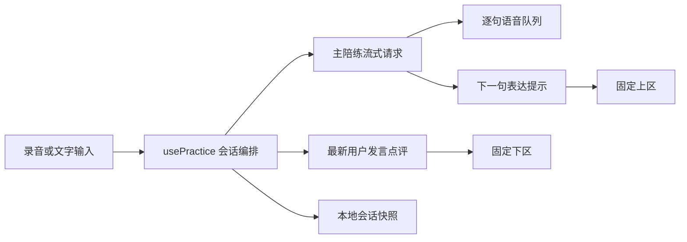

# 架构与数据流

## 项目名称与兼容标识

「轻松说」的用户侧名称集中在 `lib/brand.ts`。HTML 元数据、npm 包元数据与文档同步改名；历史记录、存储键 `morrow:*` 及本机请求标记不做破坏性迁移。页面和导出使用新名称，历史消息仍使用当时的角色名。

## 音色快捷面板

`VoicePicker` 嵌入右上角 `SettingsDialog` 的“语伴音色”页签；主屏移除独立音色入口。`lib/voicePresets.ts` 集中维护已验证的系统音色、排序、名字、特点、适用场景与纯配置变换，`lib/speechQueue.ts` 为陪练和试听共用队列工厂，`useVoicePreview` 管理独立的试听版本及资源取消。设置面板临时暂停识别和旧声音，主回复与两个教练继续完成；选用只更新朗读字段，并同步设置草稿中的音色字段，不重建会话或改变用户的自动朗读意图。继续使用已有设置和本机路由，详细契约见 [音色切换](./voices.md)。

## 学习中心模块

学习中心、设置、历史 / 收藏通过动态导入按需加载；局部边界处理等待和失败，重试使用新的懒加载实例。`PracticeScreen` 不被这些模块的加载状态替换，媒体可见性与弹层门控仍由 `App` 传入。加载完成不改变原来的暂停或结束意图。

`App` 保持页面装配，新增学习中心视图导航；离开对话先挂起和保存，`PracticeScreen` 保持挂载但隐藏，原暂停 / 挂断意图得以保留，屏幕不活动时主动释放镜头。`LearningHub` 负责课程、复习和资料，挑战已移除，导航为课程 / 对话 / 复习 / 我的四项。`StudySession` 负责有限组的回忆 / 揭晓 / 自评。`lib/lessons.ts` 声明十二节任务并转换为统一 `Scene`；`lib/learning.ts` 负责数据校验、错题、自评排期和当前语言组合的统计。样式在 `learning.css`，继续使用既有语义色变量。

## 自定义训练模块

场景弹窗按需打开 `CustomTrainingDialog`，不新增导航或预设分类。`lib/customTraining.ts` 管理自由要求、参考材料、模板白名单与场景快照；新增 `morrow:custom-trainings`，显式保存最多二十个模板。`Scene.training` 使默认语言也生成真实开场，并为提示教练提供当前材料；下区点评的边界保持不变。完整材料只驻留当前场景和显式模板，不另写入历史会话。

`trainingImport` 按需加载 PDF.js / Mammoth，文档本机转纯文本；图片缩小后通过现有主模型的 `image_url` 请求转为文字材料。表单维护取消控制器与版本，所有读取结果先进入待确认预览，不直接覆盖材料。设置、输入、清空、关闭和卸载具有明确资源释放路径。接口、体积、存储与媒体验收见 [自定义训练](./custom-training.md)。

会话新增可选 `lessonId`、`goalTurns` 与 `isDemo`。新增本地键 `morrow:corrections`（最多三百条原句与改进建议）和 `morrow:learning`（昵称、每日目标、复习排期及最多一千条事件）。课程和成长从现存快照派生，无新后端；精确规则与历史兼容限制见 [学习功能文档](./learning.md)。

`usePractice` 新增按消息 ID 的翻译请求与缓存、独立重练状态及取消版本。重练沿用当前识别实现，提交仅发给点评模型，不调用主回复、不修改主消息、不写入错题或课程进度。重练结果使自动开麦门控暂停，显式再练或退出后恢复。学习页面通过 Hook 的可见标志阻止隐藏的主对话自动播报，显式复习听读仍可使用同一语音队列。

## 应用边界

持久化设置通过 normalizePreferences 共用白名单；历史与收藏使用 saveSessions / savePhrases 统一规范化，嵌套消息与复习事件也只保留约定字段。设备音色订阅由 useBrowserVoices 共用。Word 在解析前通过 docxContainer 核对 ZIP 容器及实际展开字节，取消解压流后才退出；不支持的设备明确拒绝。Vite 构建通过 buildGuard 检查已知服务端凭据明文与 public / bundle 非公开文件。审查范围和剩余边界见 [安全审查](./security-review.md)。

移动优先单页应用，附带可选的本机 MiniMax 代理，无自建数据库和后台任务。React 负责界面，`usePractice` 统一控制会话副作用；`useMediaSession` 编排自动进入、聆听、暂停和结束，`lib/sessionPolicy.ts` 统一判断媒体会话状态与开麦条件；`lib/core.ts` 管理供应商协议、提示与响应校验；`lib/voice.ts` 定义语音契约与浏览器队列；`lib/minimaxSpeech.ts` 封装 MiniMax 协议与播放队列，`lib/minimaxRecognition.ts` 管理录音、切句、WAV 编码和转写；`server/minimaxProxy.ts` 保管本机凭据并限定转发路由；`lib/camera.ts` 管理镜头资源；`lib/storage.ts` 管理本地数据与导出；`lib/theme.ts` 管理主题定义、存储与文档配色。

## 半双工状态机

| 状态         | 可进行                       | 退出条件                                            |
| ------------ | ---------------------------- | --------------------------------------------------- |
| ready        | 开始录音、发送文字、重听     | 对应操作开始                                        |
| listening    | 继续说话、结束录音、听读     | 浏览器结束识别、用户停止或选择听读                  |
| transcribing | 等待当前片段转写、暂停或结束 | 转写完成或失败；不允许重听、填例句和开启新录音      |
| thinking     | 接收助手流式响应             | 首句开始播放；或文字回复完成                        |
| speaking     | 听助手说、跳过播放           | 播放与生成均结束则 ready；跳过且仍在生成则 thinking |

录音结束自动发送可以关闭；关闭后转写保留在输入框等待确认。整轮识别 `onend` 回调先恢复 ready，再进入发送流程；空白转写结束设置 `no-speech` 并暂停，避免反复启动。`speechTiming` 集中管理 `speechPauseMs`，默认三秒，支持二 / 三 / 五秒；旧设置安全迁移。MiniMax 使用本机音量检测，继续发声重置静默计时，初始十秒无语音则暂停，最长单段六十秒。

`BrowserRecognition` 将浏览器原生分段事件适配成整轮契约，使用 continuous / interim 模式，早到的原生结束不直接提交，有文字时尝试跨片段续听。累计快照替换与已完成片段拼接分离，避免重复文字。等待与重启定时器由 abort、后台和错误统一清理，最终只向 Hook 发送一次结束；底层权限和平台仍影响续识别能力。详情见 [停顿与点评恢复](./conversation-timing.md)。

两种识别实现共用 `Recognition` 契约；MiniMax 在录音停止时触发 `onprocessing`，进入 transcribing。通过 MediaRecorder 获得设备支持的容器，在内存解码并混合为单声道 PCM16 WAV；麦克风在停止时立即释放，不等网络完成。权限、解码和转写都检查内部版本；取消后的权限返回立即关闭流，取消的转写不发结果。完整语音路径为 ASR → 文字模型 → TTS。

`interruptListening` 只取消当前识别，清空旧识别回调并递增 `recognitionEpoch`；保留草稿，不递增整个会话的 `epoch`，因此较慢的灵感与点评请求仍可完成。切换文字、按需听读和主回复完成后的媒体挂起复用该路径。

流式文本按句末标点切分，使用统一的 `SpeechQueue` 契约选择设备声音或 MiniMax 合成，首句不必等待全文完成。没有句末时在流完成后朗读剩余内容。播放队列跟踪待播内容和生成结束状态，避免第一句读完就错误地释放麦克风。设备声音每个待播片段在 2500ms 内未触发 `onstart` 时恢复；已播放的片段按词数与语速估计时长。MiniMax 顺序合成播放，最多预取下一句，同一回复复用 Audio 与内存 Blob URL；使用独立 `isPlaying` 区分句间等待与实际播放，片段版本隔离旧事件及迟到的 play 拒绝。换源后撤销旧 URL，全部完成或取消时释放播放器与 URL；音频就绪后 2500ms 未开始播放则恢复，播放期间按媒体时长设置看门狗。播放器正常音量不等同于系统音量控制，蓝牙诊断边界见 [播放排查](./audio-playback.md)。

跳过只取消语音队列，不取消主回复、表达提示或点评请求；主回复仍在生成时退回 thinking，完整生成后才允许进入下一轮识别。

## 会话与并发隔离

会话意图 `SessionIntent` 为 active / paused / ended，初始 active，不存在 idle 或单独的 startSession。`getSessionState` 将用户意图与弹层、页面可见性合并成当前媒体状态；ended 优先于临时挂起，用户 paused 优先于恢复前台或关闭弹层。

只有当前会话 active、语音状态 ready、无主请求错误、无识别错误、无待确认草稿、无待恢复回复，且页面在前台、未打开弹层 / 文字模式时，`canStartListening` 才允许排程新一轮识别。自动排程延迟 400ms，回调执行前再次校验；Alt + M 也经过同一门控。识别错误恢复时，“继续”可沿用用户手势立即尝试开麦；常规播放结束后仍保留尾音间隔。停止后清除排程，识别异常将意图转 paused。麦克风权限、自动播放与识别服务能力仍由浏览器控制；失败必须展示恢复提示，不循环触发权限请求。

初次进入与新会话在自动朗读开启时尝试播放一次开场；浏览器未触发实际播放时，由播放启动超时恢复并提示。自动朗读关闭时直接进入识别排程。新会话重置意图为 active；用户在结束后点击底部原有的“继续”控制时，先创建新会话再自动进入，不恢复已结束会话的媒体。

弹层或后台挂起不改变原用户意图。`suspend` 在主回复已完成时只中断识别、停止声音和计时，保留独立教练请求；主回复仍在生成时调用 `abort`，将用户历史保留为 `pendingReply`，去掉流式占位和半截助手回复。回到 active 时优先从原用户历史重新生成该回复，不重复添加用户消息。

按需听读入口 `speakOnDemand` 可在 ready 或 listening 时使用；它先选择性中断识别，再记录 `requestedSpeech` 并播放。手动听读被挂起时，恢复同一个例句或改进表达，而非误读最后一条主回复；普通主回复播放被挂起则从该回复开头重听。暂停意图不因听读而变为 active。

草稿通过同步的 `draftRef` 与 React 状态一同更新，保证同一帧内收到的转写也参与例句覆盖检查。`prepareExampleDraft` 保留非空且不同于例句的用户草稿并提示，不覆盖；录音中断后的草稿由用户确认发送或放弃。提交去除首尾空白后超过 3000 字符时保留完整输入并拒绝发送，不截断后提交。

摄像头只提供本机 video 预览，CameraController 通过请求版本处理异步权限竞态；stop 会释放已有轨道，后到的过期媒体流也立即 stop。结束、后台、离开页面与卸载释放镜头；回前台不自动重开。`pagehide` 还会取消语音与请求并保存有用户发言的记录。

- 会话版本 `epoch` 发生新轮次、切换、取消时递增。
- 请求使用 AbortController；默认 35 秒超时覆盖请求及响应正文读取，结束或取消时释放响应流。
- 主陪练、点评独立请求；主陪练完成后触发表达提示。
- 每个结果先确认版本；表达提示与点评分别使用独立请求版本，避免同一会话中手动重试返回顺序颠倒。
- 同一教练新请求主动中止该角色的旧请求；独立控制器槽位与版本校验同时保留，另一教练及主回复不受影响。主回复失败后的重试复用本轮版本，避免使慢点评失效后一直停留在加载状态。
- 进入新轮次会取消上一轮仍未完成的请求；旧辅导内容保留到对应新结果完成。
- 取消、组件卸载释放请求、识别回调、朗读与定时器。界面不依赖请求成功才能恢复操作。

## 上下文与结构化响应

主陪练最多传入最近 24 条消息；提示教练最近 6 条；点评教练传入截止最新用户发言的最近 3 条。上下文包含相应角色的系统提示。

两个辅导请求经 `requestCoachCompletion` 统一解析和字段校验；它定位唯一完整 JSON 对象，兼容规范围栏及完整思考块，不修补非法 JSON，也不接受歧义多对象。格式 / 截断失败最多一次重新整理，共用总超时和取消信号。新发言清除旧点评，防止错误后旧内容被误读为最新评价。主陪练使用自然练习语言聊天，纠错和建议由专属教练负责。

供应商 SSE 按空行分隔事件，多行 `data:` 合并后解析 JSON；UTF-8 解码器跨网络包保留状态，处理 CRLF 与缺少末尾换行。`[DONE]` 立即结束消费并取消仍开放的响应流，不等待供应商主动断开。标准非流式 JSON 使用相同的正文读取、超时与释放流程。

累计回复内容上限为 64 × 1024 字符；单个 SSE 事件的 data 缓冲、未完成行缓冲和非流式 JSON 封包上限为 256 × 1024 字符，均按 JavaScript 字符串长度计数。响应字段先检查结构与 `message` / `delta.content` 类型；出现 `error` 字段、非法 JSON、无效 UTF-8 或超限时返回可读错误，不把供应商原始错误正文直接展示给用户。具体契约见 [供应商接入指南](./providers.md)。

## 本地数据

| 键                | 存储位置       | 内容与生命周期                                           |
| ----------------- | -------------- | -------------------------------------------------------- |
| morrow:key        | sessionStorage | 当前标签页供应商密钥；刷新保留，浏览器恢复标签页可能保留 |
| morrow:speech-key | sessionStorage | 直接模式的独立 MiniMax 语音密钥；不进入长期偏好          |
| morrow:settings   | localStorage   | 供应商地址、模型、难度、语速与偏好，不含密钥             |
| morrow:sessions   | localStorage   | 最近最多 100 个会话快照                                  |
| morrow:phrases    | localStorage   | 最近最多 500 个收藏短语                                  |
| morrow:theme      | localStorage   | 独立的主题 ID；刷新恢复，不包含在供应商 Settings 中      |

会话模型包括 id、ISO 时间、场景、标题、近似练习秒数、消息数组、近似表达词数及两种语言代码。消息包括 id、role、content、可选 translation 和 companionName。新助手消息保存当时音色对应的称呼；读历史校验并限制名字长度，旧消息显示中性的“语伴”。无新增存储键。存储失败通过提示反馈，不因此阻塞聊天。历史与收藏在读取时检查必要结构。

错题对象逐字段构造，`LanguagePair` 类型不视为运行时边界；禁止直接展开传入的设置。`sanitizeStoredCorrections` 在首屏挂载时迁移旧记录，`readCorrections` 同样返回并按需回写白名单字段。规范记录不重复写入，迁移失败在首屏提示。重试点评变为无需纠错时删除同一消息的过期错题；不因重试保留模型已撤回的建议。

保存会话先按 ID 替换快照并保留最近 100 条，再在 React 状态更新器之外写入存储和通知；`sessionsRef` 同步最新列表，避免同一帧保存使用旧记录，也避免 StrictMode 重放状态更新器时重复执行持久化副作用。

本机模式额外在忽略的 `.env.local` 保存 `MINIMAX_API_KEY`，只由 Vite 服务端读取。`loadInitialSettings` 查询只含布尔值的状态接口，为首次本地使用配置 MiniMax；页面与会话存储只持有占位值。用户保存过的其他供应商选择不会被覆盖。代理只接受回环连接及同源调用，固定目的域和路由，取消与超时同时传递至上游。静态构建不附带此服务；边界见 [供应商接入指南](./providers.md)。

## 语言组合与媒体

`lib/languages.ts` 集中管理 BCP-47 校验、常用选项、显示名、文字方向、分句和 MiniMax 覆盖范围。`Settings.supportLanguage` / `practiceLanguage` 传入三个角色的提示词构造器；辅导 JSON 保持既有字段名，`en` / `zh` 分别表示练习表达与辅助释义，不代表固定语种。

`LanguageDialog` 只编辑语言字段，`App` 应用时先调用 `newSession(scene, nextSettings)` 保存旧记录，再同步页面设置与持久化。该方法同步更新场景、设置和消息引用，避免同一帧使用旧上下文。非默认组合以模型生成开场，期间保持 thinking；StrictMode 只触发一次初始开场，完成后生成灵感，不对开场生成用户点评。无密钥时显示说明，不开麦或输出英语示范。

浏览器识别与设备朗读的语言跟随练习语言；MiniMax 由组合计算 `language_boost` 及 ASR 提示，两种语言均支持时使用自动混合识别。本机代理验证传入的 ASR 提示而不再覆盖为英语。分句同时支持拉丁与中日韩、阿拉伯语、印地语常见句末；设备长句按语言分词估算时长。

历史和收藏分别保存两种语言，读取旧数据时迁移为中文 / 英语。收藏按语言组合去重，听读使用收藏自己的语言。详细边界与契约见 [两种交流语言](./languages.md)。

## 主题定义与同步

主题 ID 为 `violet`、`ocean`、`forest`、`sand`，对应暮色紫、海盐蓝、森林绿与浅色奶油白。主题模块读取并校验独立的 `morrow:theme` 存储值；缺失、无效或访问存储失败时回退 `violet`。写入失败只影响刷新后的保留，当前页面仍即时更新，并通过提示反馈。

切换主题同步根元素 `data-theme`、`color-scheme` 与页面 `theme-color`，CSS 使用共用语义变量控制背景、面板、文字与交互色。`App` 通过 `storage` 事件同步同源其他标签页的主题修改。主题切换本身不保存模型设置、不取消陪练请求、不创建新会话，也不修改两个辅导区的业务状态；主题选项所在弹层仍遵循媒体挂起规则。

## 扩展路线

正式多人使用需扩展带鉴权的 HTTPS BFF：用户身份、服务端持久化、限流、指标和账单；当前本机代理不能直接公开。后续可评估双向流式 TTS 和增量 ASR 以继续降低延迟。接口应遵循 CONTRIBUTING.md 约定，先补文档和测试，再接入客户端。
